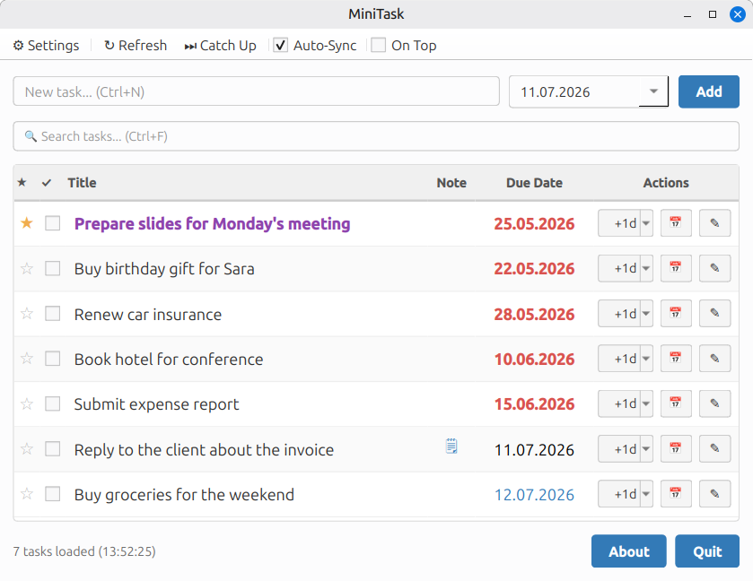
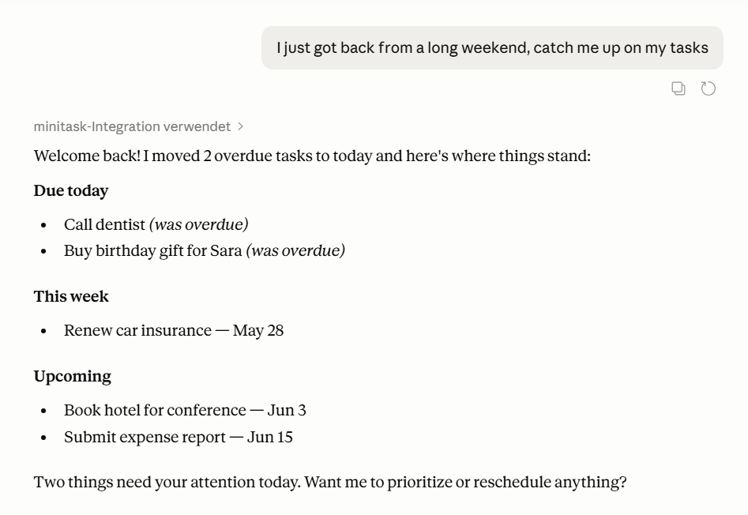
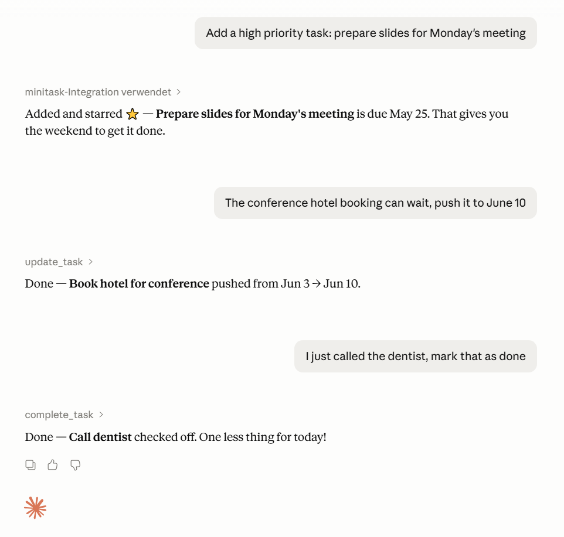

# MiniTask


A lightweight CalDAV task manager desktop application built with PySide6 (Qt6) and python-caldav.



## Features

- **AI assistant support** via the separate [MiniTask MCP](https://github.com/Stefan-Schmidbauer/minitask-mcp) server — manage the same tasks in natural language from any MCP-compatible client
- Connect to any CalDAV server (e.g. Nextcloud, mailbox.org, Radicale)
- Create, edit, and complete tasks with due dates and free-text notes
- Calendar popup for date selection
- Postpone tasks by +1 day, +1 week, or +1 month
- Set any task to today with one click
- "Catch Up" — set all overdue tasks to today at once
- Star/prioritize important tasks
- Color-coded due dates (overdue, today, future)
- Search and filter tasks
- Auto-sync every 60 seconds (toggleable)
- Undo completed (deleted) tasks — optional, with a configurable grace period (1–60 s)
- Keyboard shortcuts for fast workflow
- Always-on-top mode
- Secure credential storage via system keyring
- Remembers window position between sessions
- Single instance — launching MiniTask again brings the running window to the front instead of opening a second one

## Requirements

- Python 3.12+
- A CalDAV server with task/todo support

## Installation

```bash
git clone https://github.com/Stefan-Schmidbauer/minitask
cd minitask
```

### Linux (Debian/Ubuntu)

MiniTask uses [Quickstrap](README.quickstrap.md) for installation and startup.

```bash
./install.py   # run once to set up the virtual environment
./start.sh     # start the app
```

`./install.py` interactively sets up a virtual environment and installs system dependencies (`libgl1`, `libegl1`) and Python packages (`PySide6`, `caldav`, `icalendar`, `keyring`). After that, use `./start.sh` to launch the app.

### Windows (manual)

The desktop app works on Windows, but there is no automated installer. Set up manually:

1. Install **[Python 3.12+](https://www.python.org/downloads/)**
   - Run the installer and make sure to check **"Add Python to PATH"** — without this, the `python` command won't be recognized in the terminal
   - Verify the installation by opening a terminal (`Win+R` → `cmd`) and running `python --version`

2. Open a terminal in the MiniTask directory and run:

```cmd
python -m venv venv
venv\Scripts\pip install PySide6 caldav icalendar keyring
```

   This installs Qt (via PySide6) along with all required libraries — no separate Qt installation needed. On Windows, PySide6 bundles everything including the Qt DLLs, unlike Linux where some system libraries (`libgl1`, `libegl1`) must be installed separately.

   > **Note:** During `python -m venv venv` Windows may show an "Access Denied" dialog for a file called `lib64`. This is a symlink Python tries to create but doesn't need on Windows — click **Skip** and the virtual environment will work fine. To prevent this dialog permanently, enable **Developer Mode** in Windows Settings → System → For developers.

## Usage

**Linux:**
```bash
./start.sh
```

**Windows:**
```cmd
venv\Scripts\python main.py
```

On first launch, you will be prompted to enter your CalDAV server credentials and select a calendar.

Only one MiniTask instance runs per user. Starting it again (from the menu, a launcher or `./start.sh`) does not open a second window — the running one is restored and brought to the front.

### Desktop Entry (Linux)

To start MiniTask from your application menu, create `~/.local/share/applications/MiniTask.desktop`:

```ini
[Desktop Entry]
Type=Application
Name=MiniTask
Exec=/path/to/minitask/start.sh
Icon=/path/to/minitask/assets/minitask.png
Terminal=false
StartupNotify=true
StartupWMClass=MiniTask
```

`StartupNotify=true` matters on **Wayland**: compositors only let a window take focus with an activation token, which the launcher passes on only for entries with startup notification. MiniTask forwards this token to the already running instance — without it, the existing window may only be highlighted in the taskbar instead of coming to the front. On X11 it works either way.

### Developer Mode (Linux)

```bash
source quickstrap/activate.sh
python main.py
```

## Keyboard Shortcuts

| Shortcut   | Action              |
|------------|---------------------|
| `Ctrl+N`   | Focus new task input |
| `Ctrl+F`   | Focus search         |
| `F5`       | Refresh tasks        |
| `Ctrl+Z`   | Undo last completion |
| `Escape`   | Clear search         |

## Configuration

Settings are stored in:

- **Linux:** `~/.config/minitask/settings.json`
- **Windows:** `%APPDATA%/minitask/settings.json`

### Credential Storage

Passwords are stored securely in the system keyring and never written to the config file in plain text:

- **Linux:** GNOME Keyring or KWallet (accessed via subprocess to avoid Qt/D-Bus conflicts). A running keyring service is required (e.g. `gnome-keyring`, `kwallet`).
- **Windows:** Windows Credential Manager, accessed directly — no additional setup needed.

## AI Assistant Integration (MCP)

MiniTask itself is a desktop app only. To manage your tasks in natural language from an AI assistant (Claude Code, Claude Desktop, [Cowork](https://www.anthropic.com/product/claude-cowork) or any other MCP-compatible client), use **[MiniTask MCP](https://github.com/Stefan-Schmidbauer/minitask-mcp)** — a separate MCP server that works on the same CalDAV tasks and follows the same model as the app.

> **Moved:** Earlier versions of MiniTask shipped the MCP server in this repository (`mcp_server.py`, `setup_credentials.py`, `MCP.md` and the `.mcp.json.*.example` files). It now lives in its own repository, [minitask-mcp](https://github.com/Stefan-Schmidbauer/minitask-mcp), and runs as one shared instance on a server, reached over HTTPS — no longer as a local subprocess next to the desktop app.
>
> If you used the old setup:
>
> - Remove the `minitask` entry pointing to `mcp_server.py` from your `.mcp.json` — that file no longer exists here.
> - Set up MiniTask MCP as described in its README and connect your client to its HTTPS endpoint.
> - The tools and their arguments are unchanged, but nothing is shared with the app any more: the CalDAV account is configured on the MCP server, not read from the desktop app's keyring.
> - The `mcp` Python package is no longer needed in MiniTask's virtual environment.


*"Catch me up on my tasks" — Claude moves overdue items to today and returns a structured overview.*


*Add a starred task, push a deadline, mark one done — natural language, no context switching.*

## Third-party Libraries

MiniTask is built on the following open-source libraries:

| Library | Description | License |
|---|---|---|
| [PySide6](https://doc.qt.io/qtforpython/) | Qt6 bindings for Python — UI framework | LGPL-3.0 / GPL-2.0 / GPL-3.0 |
| [caldav](https://github.com/python-caldav/caldav) | CalDAV client library | MIT |
| [icalendar](https://github.com/collective/icalendar) | iCalendar format parser and generator | BSD |
| [keyring](https://github.com/jaraco/keyring) | Secure credential storage via system keyring | MIT |

## Contributing

Contributions are welcome! Feel free to open issues or submit pull requests.

## License

MIT License - see [LICENSE](LICENSE) for details.

## Authors

- Stefan Schmidbauer
- Claude (AI Assistant by Anthropic)
